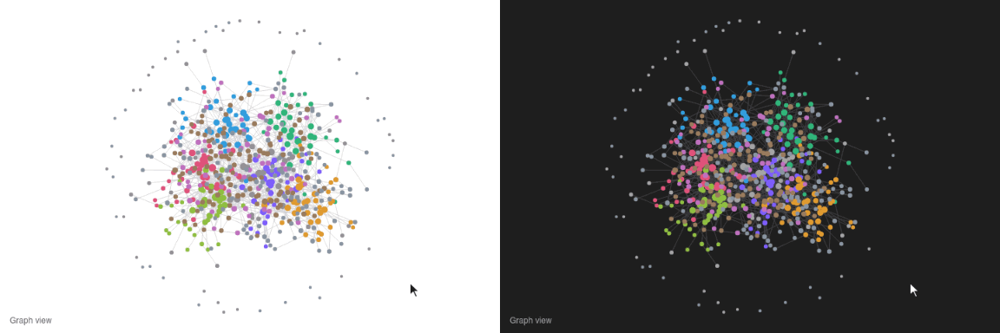
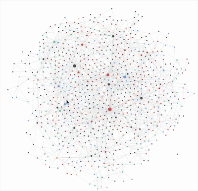
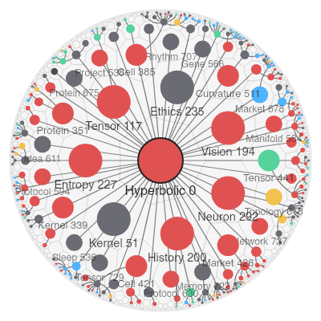

# Poincare disk view

**A focus view for vaults that have grown too large to see at once.**



<sub>A generated wiki of about 600 notes. The disk, its transitions and the return to the graph are rendered with the plugin's own code and default settings; the graph view and its menu are reconstructed for the recording. Light and dark theme side by side. Video: <a href="docs/graph-open.mp4">graph-open.mp4</a>.</sub>

Once a vault holds hundreds or thousands of notes, the graph view stops showing structure. Every note is drawn with the same weight, the links pile up into one dense tangle, and the notes around the one you are working on are lost in the crowd.

<table>
  <tr>
    <td align="center" width="50%"><br><sub>Built-in graph view, 800 notes (screen recording)</sub></td>
    <td align="center" width="50%"><br><sub>Poincaré disk view: the same 800 notes and group colors, centered on one note</sub></td>
  </tr>
</table>

Poincaré disk view starts from a single note instead of the whole vault. It puts that note at the center of a [Poincaré disk](https://en.wikipedia.org/wiki/Poincar%C3%A9_disk_model), a picture of the hyperbolic plane in which space grows exponentially toward the rim, and places the surrounding notes on a regular hyperbolic tiling:

- Notes one or two links away get large, readable nodes near the center.
- Notes farther away shrink toward the rim and fade out. They stay in view as context but no longer compete for attention.
- Click any note and the disk glides to put it at the center, unfolding its own neighborhood.

This is focus + context for your notes: one note's neighborhood in detail, and the rest of the vault as a horizon. Hyperbolic space suits link neighborhoods because both grow exponentially. A circle of radius r has circumference 2π·sinh r, so the notes two, three and four links out still fit without piling up. The approach follows the hyperbolic browser of Lamping, Rao and Pirolli (CHI '95).

## Use

- Open it from the ribbon (circle icon) or the command **Poincaré disk view: Open view**.
- The view starts at the note you opened most recently, or at the most linked note.
- In Obsidian’s built-in Graph view, right-click a note and choose **Open in Poincaré disk view**: the disk opens over the graph, and the graph’s own nodes slide, grow or shrink onto it around that note. The graph view stays as it is underneath. Press <kbd>Esc</kbd>, the tab’s back button (←) or the mouse back button to return: the nodes move back to where the graph draws them and the disk lifts off. **Open in Poincaré disk view (new tab)** keeps the graph and opens the disk next to it. Both items are also in the file menu elsewhere (file explorer, tab header).
- In the Graph view, **Search center note…** (top left) finds any note by name and opens it on the disk over the graph, without looking for it among the nodes. Also the command **Poincaré disk view: Search for a center note from the graph view**.
- **Click** a note to move it to the center. **Drag** to move around the disk.
- **Double-click** a note to open it. Hold <kbd>Cmd</kbd>/<kbd>Ctrl</kbd> to open it in a new tab.
- Hover a note for its path, distance and tags.
- With **Follow active note** on, the view follows the note open in the editor.
- The buttons at the top right: find a note to put at the center, re-center after dragging, and settings.

## Settings

The settings panel (gear button) changes the view right away:

- Links take the graph view's color and thickness and nodes its node size, so the disk looks like the graph. **Link thickness** and **Link contrast** adjust the links; **Disk shading** and **Tiling grid** (off by default) add a gray disk and the tiling lines; **Fade with distance** (on) makes notes and links fainter toward the rim.
- **Color by**: the groups from the graph view settings (default), or distance from the center. Distance palettes (one is built from your theme accent) make near notes stand out most from the background: darkest in a light theme, lightest in a dark one.
- **Tiling**: the regular hyperbolic tiling {p,q} the notes are placed on.
- **Layout**: max hops, hub penalty, max children per note (extras are bundled into a +N cell), hide radius.
- **Size**: cell size (spacing of the tiling), node size, label threshold, cross-link opacity, fade amount, link thickness and contrast.
- **Show orphans** lets notes without links appear in the disk’s note search and become the focus automatically. You can always center a note explicitly from its file menu.

Graph view groups are read from `.obsidian/graph.json`. Only `path:`, `file:`, `tag:`, `-` and `OR` are supported; plain words match the file path, not the note content.

## Install

Until the plugin is listed in Community plugins: download `main.js`, `manifest.json` and `styles.css` from the latest release into `<vault>/.obsidian/plugins/poincare-disk-view/`, then enable the plugin. Or install with [BRAT](https://github.com/TfTHacker/obsidian42-brat) using this repository's URL.

Requires Obsidian 1.7.2 or later. Desktop only for now.

## Privacy

The plugin works entirely offline. It makes no network requests and collects no telemetry.

To build the graph it reads, for every Markdown note in the vault:

- the note's path (via `vault.getMarkdownFiles()`), so notes can be placed and opened,
- its resolved links (`metadataCache.resolvedLinks`), which define the graph,
- its tags (from the metadata cache), for graph view group queries such as `tag:#idea`.

It also reads the graph view's color groups from `.obsidian/graph.json`. Note contents are never read, nothing is written to your notes, and this data stays in memory on your device.

## Development

```bash
npm install
npm run dev     # watch and rebuild main.js
npm test        # Node 22.18+ (runs the TypeScript tests directly)
npm run build   # type check and production build
```

Release: `npm run bump -- 0.2.0`, commit, then push a tag `0.2.0`. GitHub Actions builds a draft release with the plugin files.

## Credits

Poincaré disk view is made by [@hyewonnavie](https://github.com/hyewonnavie) and [@jmj3078](https://github.com/jmj3078).

## License

MIT
